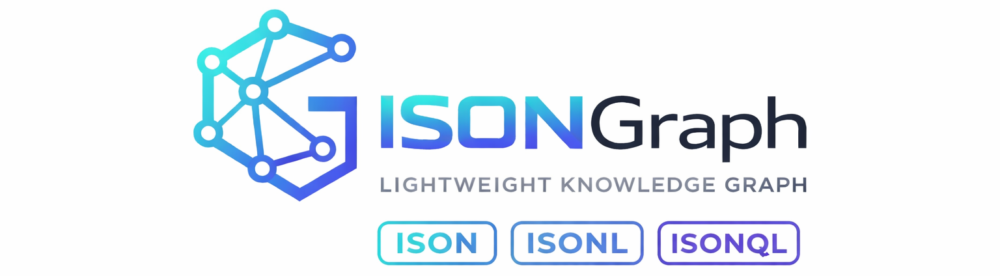
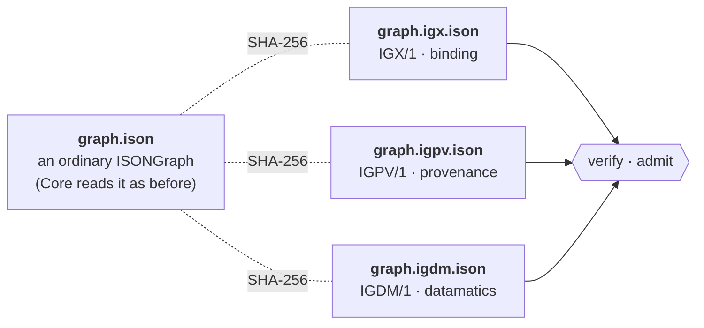
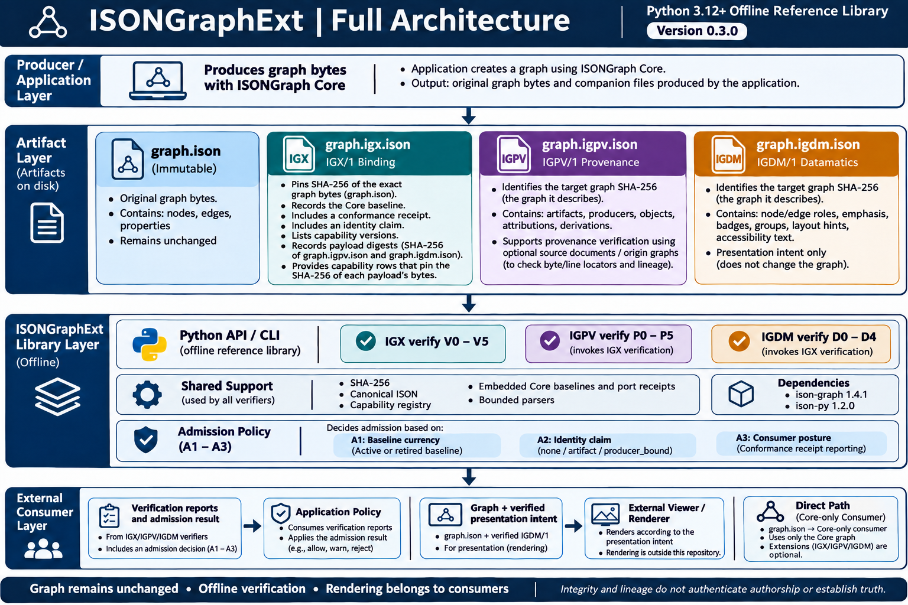
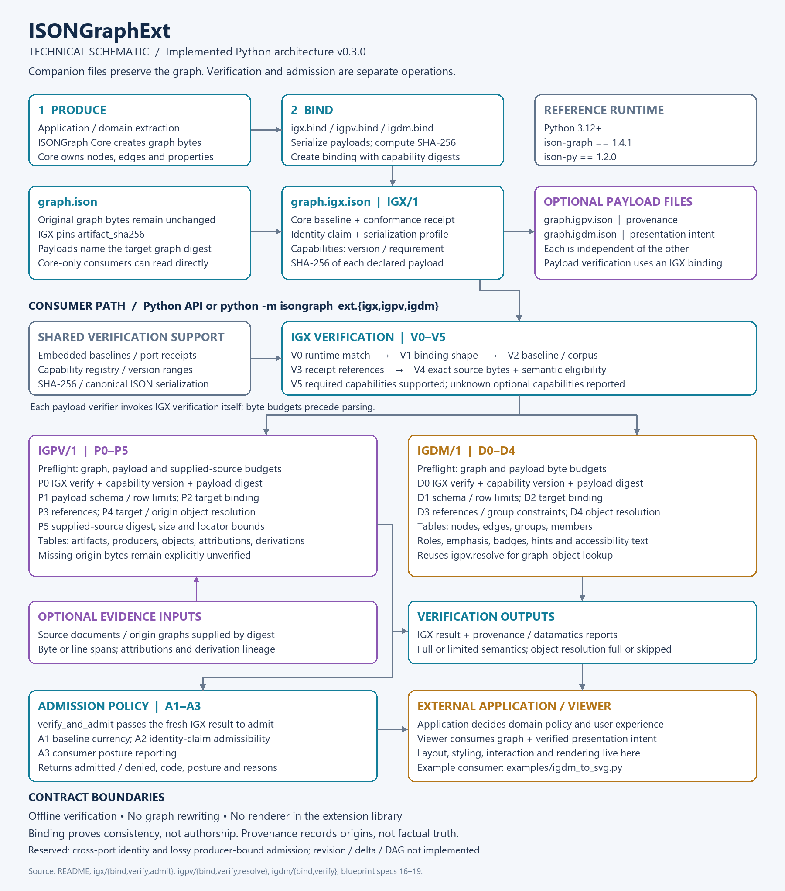

<p align="center">
  
</p>

<h1 align="center">ISONGraphExt</h1>

<p align="center">
  <strong>Prove what a graph is, where it came from, and how to show it — without changing the graph.</strong>
</p>

<p align="center">
  <a href="https://github.com/ISON-format/isongraph-ext/actions/workflows/ci.yml"></a>
  <a href="LICENSE"></a>
  <a href="https://pypi.org/project/isongraph-ext/"></a>
  
  
  
</p>

<p align="center">
  <a href="#try-it-in-two-minutes">Try it</a> ·
  <a href="#what-you-get">What you get</a> ·
  <a href="#from-the-command-line">CLI</a> ·
  <a href="#examples">Examples</a> ·
  <a href="#where-it-fits">Where it fits</a> ·
  <a href="#architecture">Architecture</a> ·
  <a href="#status-and-limits">Status</a> ·
  <a href="docs/blueprint/README.md">Specs</a>
</p>

---

[ISONGraph](https://github.com/ISON-format/isongraph) stores a graph as a compact, token-efficient file. That file deliberately says nothing about **who made it**, **where its facts came from**, or **how a viewer should draw it**. ISONGraphExt answers those three questions with small **companion files that sit next to the graph** and are tied to its exact bytes by SHA-256. The graph itself is never modified, and everything works offline.



Core works without any of it. Add a companion only when you need the answer it gives.

## What you get

| Question | Capability | In one line |
|---|---|---|
| *Is this really the graph I was promised?* | **IGX/1** binding | Pins the exact bytes, the Core version they were written with, and an identity claim (`none`, `artifact`, `producer_bound`). Unknown capabilities are reported or refused, never silently ignored. |
| *Where did this come from?* | **IGPV/1** provenance | Attributes nodes and edges to source documents, with byte or line spans you can check against the real bytes, and records derivation lineage: *this node stands for those nodes in an earlier graph*. |
| *How should a viewer present it?* | **IGDM/1** datamatics | Renderer-neutral presentation **intent**: semantic roles, emphasis, badges, groups, layout hints and accessibility text. Never colours, fonts or coordinates. |
| *What should a viewer read, with ids that cannot be mistaken?* | **IGDC/1** consumption hints | A canonical hint document derived by a pure function from a verified IGDM/1 payload, with every node and edge address in a typed form (`i:7` is the integer 7, `s:7` the string "7"). A document that passes the consumer checks C0 to C3 is well-formed, **not verified**. |
| *What exactly did a verifier compute, and under which configuration?* | **IGAR/1** admission receipt | A canonical, **unsigned** record of what one verifier computed over exact bytes (target, binding, payload and optionally an IGDC/1 hint document) under a named verifier profile. A rejection is recorded as content, not as an error. An unsigned receipt needs a trusted delivery boundary, and a policy match is not trust. |
| *Which part of this graph do I need?* | **IGP/1** projection | Selects a bounded, deterministic subgraph from explicit anchors, relation and type allow-lists, direction, depth and budgets, and returns an ordinary graph **plus provenance for every node and edge**. Anyone can recompute it from the source and the policy. |

Each is optional and independent. A consumer that knows none of them still has the whole graph.

## Try it in two minutes

```bash
pip install isongraph-ext
```

Python 3.12+; the only dependencies are `ison-graph==1.4.1` and `ison-py==1.2.0`. To run the bundled examples or work on the code, install from a clone instead:

```bash
git clone https://github.com/ISON-format/isongraph-ext.git && cd isongraph-ext
python -m venv .venv && . .venv/bin/activate          # Windows: .venv\Scripts\activate
pip install -e isongraph-ext                         # editable install; ison-graph and ison-py are pulled in
```

Bind a graph to its bytes, verify it, then change one byte:

```python
from ison_graph import ISONGraph
from isongraph_ext import igx

g = ISONGraph()
g.add_node("person", "ada", name="Ada")
g.add_node("person", "grace", name="Grace")
g.add_edge("knows", ("person", "ada"), ("person", "grace"))
data = g.to_ison().encode("utf-8")

binding = igx.bind(data, serialization_profile="ison-v1", producer_port="python", identity_claim="artifact")
result, decision = igx.verify_and_admit(binding, data)
print("admitted:", decision.admitted, "| steps:", ", ".join(result.steps_passed))

try:
    igx.verify(binding, data + b"\n# edited")
except igx.IGXError as e:
    print("tampered:", e.code, "at", e.step)
```

```text
admitted: True | steps: V0, V1, V2, V3, V4, V5
tampered: SOURCE_BINDING_MISMATCH at V4
```

Verification is a fixed sequence of numbered steps, and every failure names the step and a stable error code.

## Project a bounded subgraph

Select what an agent, a report or a viewer needs, with proof of where every part came from:

```python
from ison_graph import ISONGraph
from isongraph_ext.igp import Policy, project
from isongraph_ext.igpv import NodeRef

g = ISONGraph()
for name in ("ada", "grace", "linus"):
    g.add_node("person", name)
g.add_edge("knows", ("person", "ada"), ("person", "grace"))
g.add_edge("knows", ("person", "grace"), ("person", "linus"))
data = g.to_ison().encode("utf-8")

policy = Policy(anchors=(NodeRef("person", "ada"),), direction="out", depth=1)
result = project(data, policy)
print("selected:", result.stats["selected_nodes"], "nodes,", result.stats["result_edges"], "edge")
print("lineage rows:", len(result.payload.derivations), "| policy digest:", result.policy_sha256[:12])
```

```text
selected: 2 nodes, 1 edge
lineage rows: 3 | policy digest: 2b7fbfb0ce34
```

The policy is a canonical file you can keep next to the graph (`policy.to_ison()`); its digest is recorded in the lineage. `result.result_bytes` is an ordinary ISONGraph, `result.payload` an IGPV/1 lineage payload, and `verify_projection` recomputes both from the source and the policy. The policy never inspects property values: you choose the anchors, IGP/1 does the structural work. Specification: [`21-IGP1-DESIGN.md`](docs/blueprint/21-IGP1-DESIGN.md).

## From the command line

```bash
python examples/supply_chain_assets.py --write out/      # makes a graph, a binding and a datamatics payload
python -m isongraph_ext.igx verify out/assets.ison out/assets.igx.ison
```

```text
meta.verification
binding_digest semantic_verification source_canonical source_semantic_eligibility source_semantic_reason steps_passed unrecognized_optional
7057257e8d09a62d5c0a03ec2983bd38155e6579e04a1446c62116c45009c292 full "true" eligible null V0,V1,V2,V3,V4,V5 x-asset-ledger
```

Output is itself ISON, so receipts can quote it verbatim. Exit codes are stable: `0` ok, `1` invalid, `2` admission denied, `64` usage.

```bash
python -m isongraph_ext.igx   admit  out/assets.ison out/assets.igx.ison
python -m isongraph_ext.igdm  verify out/assets.ison out/assets.igx.ison out/assets.igdm.ison
python -m isongraph_ext.igdc  derive graph.ison graph.igx.ison graph.igdm.ison > graph.igdc.ison
python -m isongraph_ext.igdc  verify graph.igdc.ison [graph.ison graph.igx.ison graph.igdm.ison]
python -m isongraph_ext.igar  issue graph.ison graph.igx.ison graph.igdm.ison [--profile profile.ison] [--igdc graph.igdc.ison] > graph.igar.ison
python -m isongraph_ext.igar  inspect graph.igar.ison
python -m isongraph_ext.igar  subject graph.igar.ison --target graph.ison --binding graph.igx.ison --payload graph.igdm.ison [--igdc graph.igdc.ison]
python -m isongraph_ext.igar  policy graph.igar.ison --trust-policy trust.policy.ison
python -m isongraph_ext.igar  authorize graph.igar.ison --pins SHA256SUMS --target graph.ison --binding graph.igx.ison --payload graph.igdm.ison --igdc graph.igdc.ison --trust-policy trust.policy.ison
python -m isongraph_ext.igar  recompute graph.igar.ison graph.ison graph.igx.ison graph.igdm.ison --profile profile.ison
python -m isongraph_ext.igpv  verify graph.ison graph.igx.ison graph.igpv.ison [--source SHA256=PATH]
python -m isongraph_ext.igpv  origins <graph-sha256> graph.igpv.ison --node person ada
python -m isongraph_ext.igp   project graph.ison policy.igp.ison --out out/       # writes result.ison and result.igpv.ison
python -m isongraph_ext.igp   verify  graph.ison policy.igp.ison result.ison result.igpv.ison
```

`derive` writes the hint document to standard output as UTF-8 with LF line endings, no byte-order mark and no trailing newline, and C0 accepts only exactly those bytes. Save it with a redirection that does not re-encode it (cmd.exe, Git Bash or POSIX shells). Windows PowerShell 5.1 `>` re-encodes the stream as UTF-16LE with a byte-order mark and CRLF line endings, so a file saved that way fails C0. The same applies to `igar issue`: its receipt is written to standard output as UTF-8 with LF line endings and no trailing newline, and a receipt saved through PowerShell 5.1 `>` (UTF-16LE with a byte-order mark and CRLF) fails the receipt reader (R0). Use `--igdc <out>` to write the hint document the receipt names to a file instead of redirecting it. `<out>` is overwritten if it is an existing unrelated regular file, but `issue` refuses (exit `64`, nothing written) when `<out>` is the graph, binding, payload or profile file of the same invocation, or a directory.

`igar` exits `0` ok, `1` any other `IGARError` (malformed, inconsistent or over-budget input, and `RECEIPT_RECOMPUTE_MISMATCH`, a re-run that completed and did not reproduce the receipt), `2` refused (`RECEIPT_POLICY_UNSATISFIED`, `RECEIPT_NOT_PINNED`, `RECEIPT_SUBJECT_MISMATCH`, or a re-run that cannot be made, `RECOMPUTE_UNAVAILABLE`), `64` usage (including an `issue --igdc OUT` whose `OUT` is one of that invocation's own input files, the temp file `OUT.tmp` it is written through is one of them, or `OUT` is a directory: nothing is written; a symbolic link at `OUT` that points at an input counts as that input; a pre-existing unrelated regular file at `OUT` is overwritten, and a link at `OUT` to any other file is replaced by the new file without writing to its target). A rejection receipt is content, so `issue` exits `0` for it. Only a successful `authorize` says a receipt was authorized, and it then prints the admitted digests; `inspect`, `subject`, `policy` and `recompute` each state only what they checked, and `policy` says explicitly that a policy match is not an authorization. `--pins` is read fail-closed as a strict subset of the `sha256sum` text format, not the whole format: each line is `<64 lowercase hex>`, two spaces, `<name>`, lines separated by LF or CRLF (one final terminator is optional, so an unterminated last line is accepted; a lone CR, a blank line and a second trailing terminator make the file malformed), and only the line whose name equals the receipt file's final path component counts. A binary-mode line (`<hex> *name`) makes the pin file malformed (exit `1`), and a path-qualified name never matches (the receipt is not pinned, exit `2`). Abbreviated option names (such as `--pin`) are usage errors. The trust-policy file format is in [`docs/igar-policy-format.md`](docs/igar-policy-format.md).

## Examples

Runnable demonstrations that use only the public API. Neither involves software.

| Example | What it shows |
|---|---|
| [`institutional_evidence.py`](examples/institutional_evidence.py) | Board minutes become decisions and evidence. Provenance links each node to the exact lines it came from, **rejects a tampered source**, and traces a merged decision back to the raw rows it replaced. |
| [`supply_chain_assets.py`](examples/supply_chain_assets.py) | Suppliers, facilities and components with regions, a bill of materials and visual states carried as datamatics. Also lists what the contract cannot express. |
| [`igdm_to_svg.py`](examples/igdm_to_svg.py) | A deliberately tiny, generic consumer: verify first, then draw a static SVG from the closed role vocabulary. Unknown `x-` roles are ignored, not interpreted. |
| [`core_only.py`](examples/core_only.py) | A consumer that never imports the extension package. The graph is just a graph. |

See [`examples/README.md`](examples/README.md) for how to run them, the timings, and what they do not prove.

## Where it fits

| Layer | Owns |
|---|---|
| **ISONGraph Core** | The graph: nodes, edges, properties, parsing and writing |
| **ISONGraphExt** *(this repository)* | Binding, provenance and presentation intent as verifiable companion files |
| **ISONGraph Visualize** | Layout, interaction, animation and rendering of datamatics |
| **Your application** | Domain meaning, policy and user experience |

Ext never reinterprets the document, and it carries no vocabulary from any one domain.

## Architecture

ISONGraphExt is an offline Python library with CLI entry points. **The graph stays in Core; extensions live in companion files.** The following overview shows how producers, artifacts, verification and consumers connect.

[](docs/architecture/full-architecture.png)

### Files and responsibilities

An application uses ISONGraph Core to produce `graph.ison`, containing nodes, edges and properties. It can then add the companions it needs:

| File | Responsibility | What connects it to the graph |
|---|---|---|
| `graph.igx.ison` | **Binding:** records the Core baseline, conformance receipt, identity claim and declared capabilities. | SHA-256 of the exact graph bytes. Capability rows also pin the bytes of declared payloads. |
| `graph.igpv.ison` | **Provenance:** records source artifacts, producers, object attributions and derivation lineage. | Target graph digest and serialization profile; its payload digest is declared in IGX. |
| `graph.igdm.ison` | **Presentation intent:** describes roles, emphasis, badges, groups, layout hints and accessibility text. | Target graph digest and serialization profile; its payload digest is declared in IGX. |

IGPV and IGDM are independently optional; neither requires the other. Their verification APIs require an IGX binding. A Core-only consumer can read the original graph without loading any extension.

### Verification and admission flow

The schematic expands the implementation into its verification stages, shared support modules and consumer boundary. Open the image for full-size detail, or use the [editable SVG](docs/architecture/architecture-schematic.svg).

[](docs/architecture/architecture-schematic.png)

1. **Produce and bind.** Create the graph, serialize any payloads, and create an IGX binding that records their digests. The graph bytes are unchanged.
2. **Verify the binding.** IGX checks the runtime, binding shape, Core baseline, receipt references, source bytes and capability support through V0–V5. Shared support includes embedded baselines and receipts, canonical ISON serialization, SHA-256 and a capability registry.
3. **Verify each supplied payload.** IGPV runs P0–P5 to check the payload binding, structure, references, graph objects and supplied source locators. IGDM runs D0–D4 to check its binding, structure, references and graph objects. Each payload verifier invokes IGX verification itself. Byte and row budgets bound input processing; unavailable provenance evidence remains explicitly unverified.
4. **Apply admission policy.** `verify_and_admit` passes the fresh verification result into admission: A1 checks baseline currency, A2 checks whether the identity claim is admissible, and A3 reports consumer posture. Successful verification and permission to use the binding are separate results.
5. **Consume the result.** Applications decide how to use the reports and admission decision. Viewers combine the graph with verified IGDM intent and choose layout, styling and interaction. Rendering belongs to the consumer; Ext supplies no renderer.

The reference runtime pins `ison-graph==1.4.1` and `ison-py==1.2.0`. These checks establish byte consistency and checkable lineage; they do not authenticate authorship or establish that source statements are true. See the [architecture notes](docs/architecture/README.md) for source references and verification-order details, and the [normative specifications](docs/blueprint/README.md) for the complete contracts.

## Built to be checked

- **Byte-exact.** Companion files are canonical by construction: one graph, one companion, one set of bytes, one SHA-256.
- **Specified before coded.** Each capability has a frozen specification in [`docs/blueprint/`](docs/blueprint/README.md); the code follows it, never the reverse.
- **Conformance vectors.** 217 byte-exact vectors in [`vectors/`](vectors) (IGX/1 35, IGPV/1 71, IGDM/1 50, IGP/1 61), plus 142 `igs-addr` address rows, 86 IGDC/1 consumption rows and 122 IGAR/1 receipt, profile and policy rows, and the test suite, replayed in CI on every change.
- **Pinned to a measured Core.** The package embeds the Core baseline it was verified against, plus Core's own conformance receipts, so identity claims are checkable rather than asserted.
- **Limits stated plainly.** IGPV/1, IGDM/1, IGDC/1 and IGAR/1 (which both reuse the IGDM/1 limits) and IGP/1 enforce explicit input-size and row limits; IGX/1 does not define equivalent limits. Large or untrusted inputs can use a lot of memory and time, because byte limits do not bound memory. Apply your own process-level resource controls ([measurements and guidance](docs/resource-limits.md)). Verification reports the first failing step instead of guessing.

## Status and limits

ISONGraphExt is an **early-stage (alpha)** release, published on PyPI as `isongraph-ext`. Know what it does not do:

- A verified binding proves **reproducibility and consistency, not authorship**. `producer_port` is a checked claim, not authentication.
- Provenance proves origin and lineage, **not that an extracted statement is true**; a SHA-256 identifies bytes without authenticating where they came from.
- The cross-port identity claim and lossy producer-bound admission are reserved. Revision, delta and DAG capabilities are not implemented. Projection is structural only (no property filters) and supports directed simple graphs.
- IGDM/1 carries presentation **intent only** and renders nothing.
- An IGAR/1 receipt is a **claim** about what a verifier computed. It is unsigned, carries no signature and no freshness, and does not authenticate who made it. An unsigned receipt needs a trusted delivery boundary (a channel the consumer controls, with the receipt bytes pinned by digest), and a policy match is not trust: the only operation that authorizes use of a hint set is `authorize_hints`, which requires the pin, the exact bytes and a policy match together. A rejection receipt is evidence of rejection and never authorizes anything. Re-running a verification (R6) is available only in this Python reference. Specification: [`25-IGAR1-DESIGN.md`](docs/blueprint/25-IGAR1-DESIGN.md).
- IGDC/1 is a hint document for consumers, derived from inputs that were already verified. It is not an input to any verification and carries no verdict: a document that passes C0 to C3 is well-formed, not verified; only C4 (re-derivation from the payload, binding and graph) or a trusted receipt ties it to them. The Python reference is not a browser verifier. Specification: [`26-IGDC1-DESIGN.md`](docs/blueprint/26-IGDC1-DESIGN.md).
- It is a Python reference implementation. Verification is an offline cost: roughly 2 seconds for a 10,000-node graph with a capability (see [`examples/README.md`](examples/README.md)).
- The examples were verified on Windows and in Linux CI, not on macOS.

## Documentation

[`docs/blueprint/`](docs/blueprint/README.md) holds the normative texts: the Ext/Core contract (`16`), IGX/1 (`17`), IGPV/1 (`18`), IGDM/1 (`19`) and IGP/1 (`21`), plus IGDC/1 (`26`) and IGAR/1 (`25`); the IGAR/1 trust-policy file is described in [`docs/igar-policy-format.md`](docs/igar-policy-format.md). [`CHANGELOG.md`](CHANGELOG.md) lists what changed, [`CONTRIBUTING.md`](CONTRIBUTING.md) explains how to work on the project and how releases are made, and [`SECURITY.md`](SECURITY.md) explains how to report a vulnerability privately.

## License

MIT — Copyright (c) 2026 Mahesh Vaikri. See [`LICENSE`](LICENSE).
