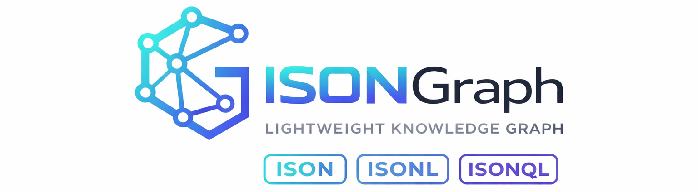

<p align="center">
  
</p>

<h1 align="center">isongraph-ext</h1>

<p align="center">
  <strong>Prove what a graph is, where it came from, and how to show it — without changing the graph.</strong>
</p>

<p align="center">
  <a href="https://github.com/ISON-format/isongraph-ext/actions/workflows/ci.yml"></a>
  
  
  
</p>

[ISONGraph](https://github.com/ISON-format/isongraph) stores a graph as a compact, token-efficient file. That file deliberately says nothing about **who made it**, **where its facts came from**, or **how a viewer should draw it**. `isongraph-ext` answers those three questions with small **companion files that sit next to the graph** and are tied to its exact bytes by SHA-256. The graph itself is never modified, and everything works offline.

```text
graph.ison          the ordinary ISONGraph; Core reads it exactly as before
  |-- graph.igx.ison    IGX/1   binding      "is this the graph I was promised?"
  |-- graph.igpv.ison  IGPV/1  provenance   "where did this come from?"
  `-- graph.igdm.ison  IGDM/1  datamatics   "how should a viewer present it?"
```

Each companion is optional and independent. A consumer that knows none of them still has the whole graph.

## Install

```bash
pip install isongraph-ext
```

Python 3.12+. Pure Python. The only dependencies are `ison-graph==1.4.1` and `ison-py==1.2.0`, pinned exactly, because the package verifies against the Core baseline it was measured with.

## Try it

Bind a graph to its bytes, verify it, then change one byte:

```python
from ison_graph import ISONGraph
from isongraph_ext import igx

g = ISONGraph()
g.add_node("person", "ada", name="Ada")
g.add_node("person", "grace", name="Grace")
g.add_edge("knows", ("person", "ada"), ("person", "grace"))
data = g.to_ison().encode("utf-8")

binding = igx.bind(data, serialization_profile="ison-v1", producer_port="python", identity_claim="artifact")
result, decision = igx.verify_and_admit(binding, data)
print("admitted:", decision.admitted, "| steps:", ", ".join(result.steps_passed))

try:
    igx.verify(binding, data + b"\n# edited")
except igx.IGXError as e:
    print("tampered:", e.code, "at", e.step)
```

```text
admitted: True | steps: V0, V1, V2, V3, V4, V5
tampered: SOURCE_BINDING_MISMATCH at V4
```

Verification is a fixed sequence of numbered steps, and every failure names the step and a stable error code.

## Project a bounded subgraph

Select what an agent, a report or a viewer needs, with proof of where every part came from:

```python
from ison_graph import ISONGraph
from isongraph_ext.igp import Policy, project
from isongraph_ext.igpv import NodeRef

g = ISONGraph()
for name in ("ada", "grace", "linus"):
    g.add_node("person", name)
g.add_edge("knows", ("person", "ada"), ("person", "grace"))
g.add_edge("knows", ("person", "grace"), ("person", "linus"))
data = g.to_ison().encode("utf-8")

policy = Policy(anchors=(NodeRef("person", "ada"),), direction="out", depth=1)
result = project(data, policy)
print("selected:", result.stats["selected_nodes"], "nodes,", result.stats["result_edges"], "edge")
print("lineage rows:", len(result.payload.derivations), "| policy digest:", result.policy_sha256[:12])
```

```text
selected: 2 nodes, 1 edge
lineage rows: 3 | policy digest: 2b7fbfb0ce34
```

The policy is a canonical file you can keep next to the graph (`policy.to_ison()`); its digest is recorded in the lineage. `result.result_bytes` is an ordinary ISONGraph, `result.payload` an IGPV/1 lineage payload, and `verify_projection` recomputes both from the source and the policy. The policy never inspects property values: you choose the anchors, IGP/1 does the structural work. Specification: [`21-IGP1-DESIGN.md`](https://github.com/ISON-format/isongraph-ext/blob/main/docs/blueprint/21-IGP1-DESIGN.md).

## Command line

```bash
python -m isongraph_ext.igx   verify graph.ison graph.igx.ison                  # exit 0 ok, 1 invalid, 64 usage
python -m isongraph_ext.igx   admit  graph.ison graph.igx.ison                  # exit 0 admitted, 2 denied
python -m isongraph_ext.igpv  verify graph.ison graph.igx.ison graph.igpv.ison [--source SHA256=PATH]
python -m isongraph_ext.igpv  origins <graph-sha256> graph.igpv.ison --node person ada
python -m isongraph_ext.igdm  verify graph.ison graph.igx.ison graph.igdm.ison
python -m isongraph_ext.igp   project graph.ison policy.igp.ison --out out/       # writes result.ison and result.igpv.ison
python -m isongraph_ext.igp   verify  graph.ison policy.igp.ison result.ison result.igpv.ison
```

Output is itself ISON, so receipts can quote it verbatim.

## What you get

| Capability | What it does |
|---|---|
| **IGX/1** binding | Pins the exact bytes, the Core version they were written with and an identity claim (`none`, `artifact`, `producer_bound`). Unknown capabilities are reported or refused, never silently ignored. |
| **IGPV/1** provenance | Attributes nodes and edges to source documents, with byte or line spans checked against the real bytes, and records derivation lineage: *this node stands for those nodes in an earlier graph*. |
| **IGP/1** projection | Selects a bounded, deterministic subgraph from explicit anchors, allow-lists, direction, depth and budgets, and returns an ordinary graph plus IGPV/1 provenance for every node and edge; recomputable from the source and the policy. |
| **IGDM/1** datamatics | Renderer-neutral presentation **intent**: semantic roles, emphasis, badges, groups, layout hints and accessibility text. Never colours, fonts or coordinates. |

## Built to be checked

- **Byte-exact.** Companion files are canonical by construction: one graph, one companion, one set of bytes, one SHA-256.
- **Specified before coded.** Frozen specifications for IGX/1, IGPV/1, IGDM/1 and IGP/1 live in the [repository](https://github.com/ISON-format/isongraph-ext/tree/main/docs/blueprint); the code follows them, never the reverse.
- **Conformance vectors.** 217 byte-exact vectors and about 590 tests are replayed in CI on every change.
- **Pinned to a measured Core.** The package embeds the Core baseline it was verified against, plus Core's conformance receipts, so identity claims are checkable rather than asserted.
- **Limits stated plainly.** IGPV/1, IGDM/1 and IGP/1 enforce explicit input-size and row limits; IGX/1 does not define equivalent limits. Large or untrusted inputs can use a lot of memory and time, because byte limits do not bound memory. Apply your own process-level resource controls ([measurements and guidance](https://github.com/ISON-format/isongraph-ext/blob/main/docs/resource-limits.md)). Verification reports the first failing step instead of guessing.

## Examples

Four runnable demonstrations (a non-software provenance graph, a supply-chain presentation graph, a minimal generic SVG adapter and a Core-only consumer) are in the [examples folder](https://github.com/ISON-format/isongraph-ext/tree/main/examples) of the repository.

## Status and limits

This is an **early-stage (alpha)** release. Know what it does not do:

- A verified binding proves **reproducibility and consistency, not authorship**; `producer_port` is a checked claim, not authentication.
- Provenance proves origin and lineage, **not that an extracted statement is true**.
- The cross-port identity claim and lossy producer-bound admission are reserved. Revision, delta and DAG capabilities are not implemented. Projection is structural only (no property filters) and supports directed simple graphs.
- IGDM/1 carries presentation **intent only** and renders nothing.
- Python reference implementation only. Verification is an offline cost: roughly 2 seconds for a 10,000-node graph with a capability.

## Links

[Source and issues](https://github.com/ISON-format/isongraph-ext) · [Changelog](https://github.com/ISON-format/isongraph-ext/blob/main/CHANGELOG.md) · [Security policy](https://github.com/ISON-format/isongraph-ext/blob/main/SECURITY.md) · [ISONGraph Core](https://github.com/ISON-format/isongraph)

MIT — Copyright (c) 2026 Mahesh Vaikri.
